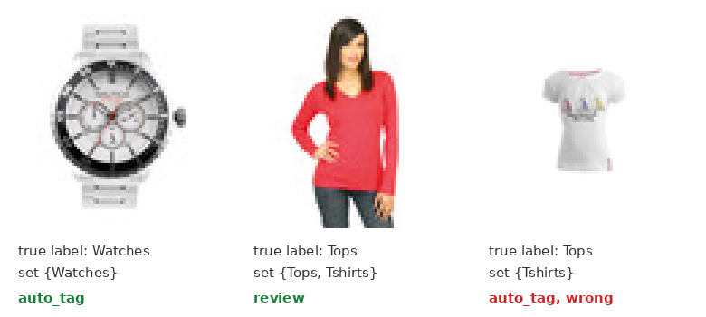
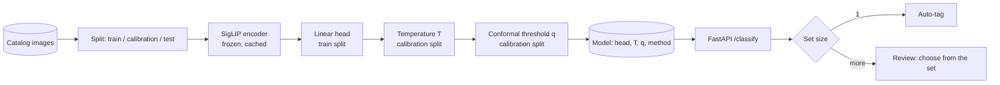

# calibrated-cv

A product-image classifier whose confidence means something: temperature scaling, conformal prediction sets, a clear auto-tag-or-review decision, and an evaluation that checks the guarantees per slice rather than assuming them.

## Demo




Three held-out test images sent to `POST /classify` (`scripts/demo_images/`), with the trained model at 95% coverage:

- **Watch:** a clear photo. The set holds one label, and it is auto-tagged.
- **Ambiguous top:** the set holds two labels, so it goes to review.
- **Top called a T-shirt:** the model is confident and wrong. Coverage of 95% means about 1 set in 20 misses the true label by design, and this is one of them.

The images are lossless copies of the dataset's 60x80 thumbnails; re-encoding them as JPEG was enough to change the borderline answer. Recorded with `scripts/record_docs.mjs` from `scripts/demo_steps.json`.

## Results

SigLIP (frozen) plus a logistic-regression head over 25 article types; 1,800 training, 600 calibration and 600 test images from a public fashion catalog dataset. Target coverage 95%.

| | |
| --- | --- |
| Top-1 accuracy | 91.2% |
| ECE before → after temperature scaling | 0.223 → **0.041** |
| Served decision | LAC conformal sets: a one-label set is auto-tagged, a larger set goes to review |
| Auto-tagged | 96.3% of images, 92.7% correct |
| Sent to review | 3.7%, true label in the reviewer's short list 95.5% of the time |
| Set coverage | 92.8% against the 95% target (see below) |

### The first design failed, and the eval caught it

The plan (ADR 1) named APS as the conformal method. On real data it was useless:

| Method | Threshold | Coverage | Mean set size | Sets of one |
| --- | --- | --- | --- | --- |
| APS | 0.9999 | 100.0% | **14.6 of 25 labels** | 3.2% |
| LAC | 0.7103 | 92.8% | **1.04** | 96.3% |

The head is confident, so almost every APS calibration score is close to 1, the threshold lands at 0.9999, and every set must collect nearly all probability mass. APS met its coverage target in a way that saves a reviewer nothing. The service now serves LAC; [ADR 2](docs/adr/0002-lac-over-aps.md) has the reasoning.

### Where the guarantee does not hold

Conformal coverage is marginal: it holds on average, not per group. The eval checks slices:

| Slice | Accuracy | Coverage |
| --- | --- | --- |
| Men | 95.5% | 96.7% |
| **Women** | 86.6% | **89.4%** |
| Apparel | 91.8% | 93.8% |
| **Footwear** | 83.6% | **86.1%** |
| Accessories | 100.0% | 100.0% |

Women's products and footwear fall more than 3 points short of the target. Overall coverage (92.8%) is also below 95% by a little more than sampling noise at 600 images (about ±1.8 points) explains. Both point to the same next step: slice-conditional (Mondrian) calibration and a larger calibration split. Full tables, including the reliability diagram and a probability-threshold baseline: [evals/RESULTS.md](evals/RESULTS.md).

## Architecture



Response from `POST /classify`:

```json
{"label": "Tshirts", "probability": 0.9731, "prediction_set": ["Tshirts"], "decision": "auto_tag"}
```

Design, failure modes and scaling path: [docs/architecture.md](docs/architecture.md). Decisions: [ADR 1](docs/adr/0001-conformal-contract.md) (conformal sets as the contract, from a structured debate) and [ADR 2](docs/adr/0002-lac-over-aps.md). Eraser sources: [docs/diagrams](docs/diagrams).

## Run it

```bash
pip install --extra-index-url https://download.pytorch.org/whl/cpu -e ".[dev]"
pytest -q                                        # unit tests on synthetic data, no downloads
CC_IMAGES=3000 python evals/run_eval.py --write  # embeds 3,000 images on CPU (~10 min), fits everything, writes evals/RESULTS.md
uvicorn calibcv.api:app_factory --factory --port 8000
```

Settings: `CC_COVERAGE` (default 0.95), `CC_METHOD` (`lac` or `aps`), `CC_IMAGES`, `CC_SEED`.

## Code map

| Path | What it does |
| --- | --- |
| `src/calibcv/calibration.py` | Softmax, temperature fitting, ECE with reliability table |
| `src/calibcv/conformal.py` | LAC and APS scores, calibration quantile, prediction sets |
| `src/calibcv/model.py` | Served model and decision rule; save and load |
| `src/calibcv/api.py` | `/classify` and `/healthz` |
| `evals/run_eval.py` | Fits everything and reports overall, per-method and per-slice results |
