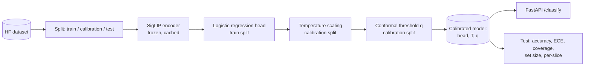
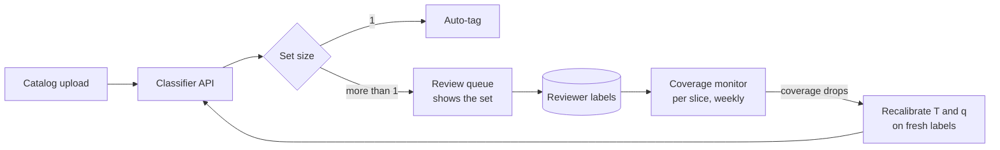
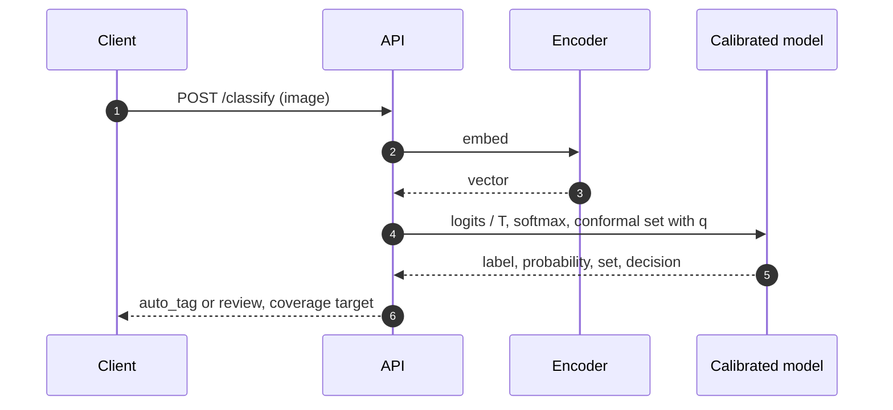

# Architecture

## Goals and non-goals

Goals:
- Classify product photos with probabilities that mean what they say.
- Abstain with a reason: send uncertain images to a person, with a short list of likely labels.
- Show where the guarantees hold and where they do not, by slice.

Non-goals:
- Top accuracy; the classifier is deliberately simple (linear head on frozen SigLIP).
- Robustness to distribution shift, which breaks both calibration and coverage.

## Current architecture (v0.1)

## Target architecture

## Request flow

## Code map

| Path | Responsibility |
| --- | --- |
| `src/calibcv/calibration.py` | Softmax, temperature fitting, ECE with reliability table |
| `src/calibcv/conformal.py` | APS scores, calibration quantile, prediction sets |
| `src/calibcv/model.py` | Calibrated model with decision rule; save and load |
| `src/calibcv/data.py` | Sample and three-way split with slice columns |
| `src/calibcv/encoder.py` | SigLIP embeddings with cache |
| `src/calibcv/api.py` | `/classify` endpoint |
| `evals/run_eval.py` | Fits everything and reports overall and per-slice results |

## Failure modes

| Failure | Effect | Mitigation |
| --- | --- | --- |
| Distribution shift (new product types, new photo style) | Coverage and calibration silently degrade | Monitor coverage on reviewed items; recalibrate |
| Small slice under-covered | Guarantee fails for that group | Per-slice report; class- or slice-conditional conformal (v0.2) |
| Calibration split too small | Noisy q and T | Calibration split size reported; at least ~1,000 images |
| Over-large sets | Review load grows | Mean set size tracked as a cost metric |

## Scaling path

1. **v0.1 (now):** temperature scaling, LAC conformal sets (APS measured and rejected, see ADR 2), per-slice report, API.
2. **v0.2:** slice-conditional (Mondrian) conformal for under-covered slices.
3. **v0.3:** coverage monitoring on reviewed items and scheduled recalibration.
